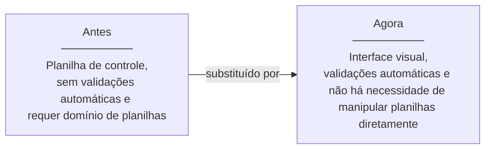
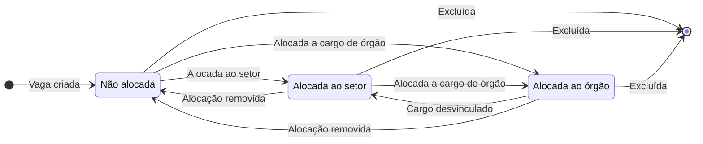
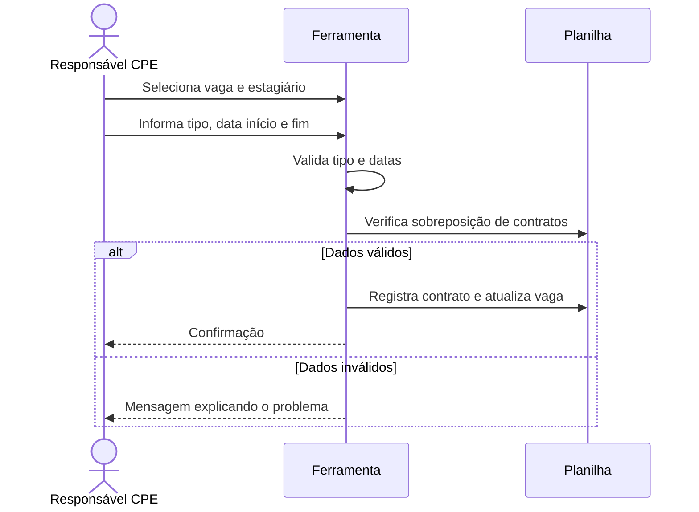
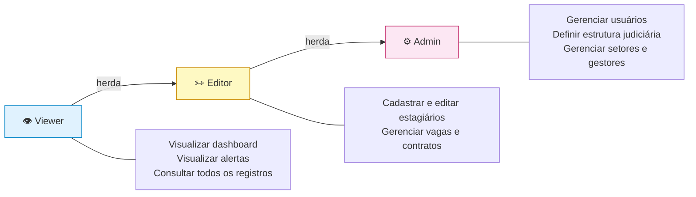
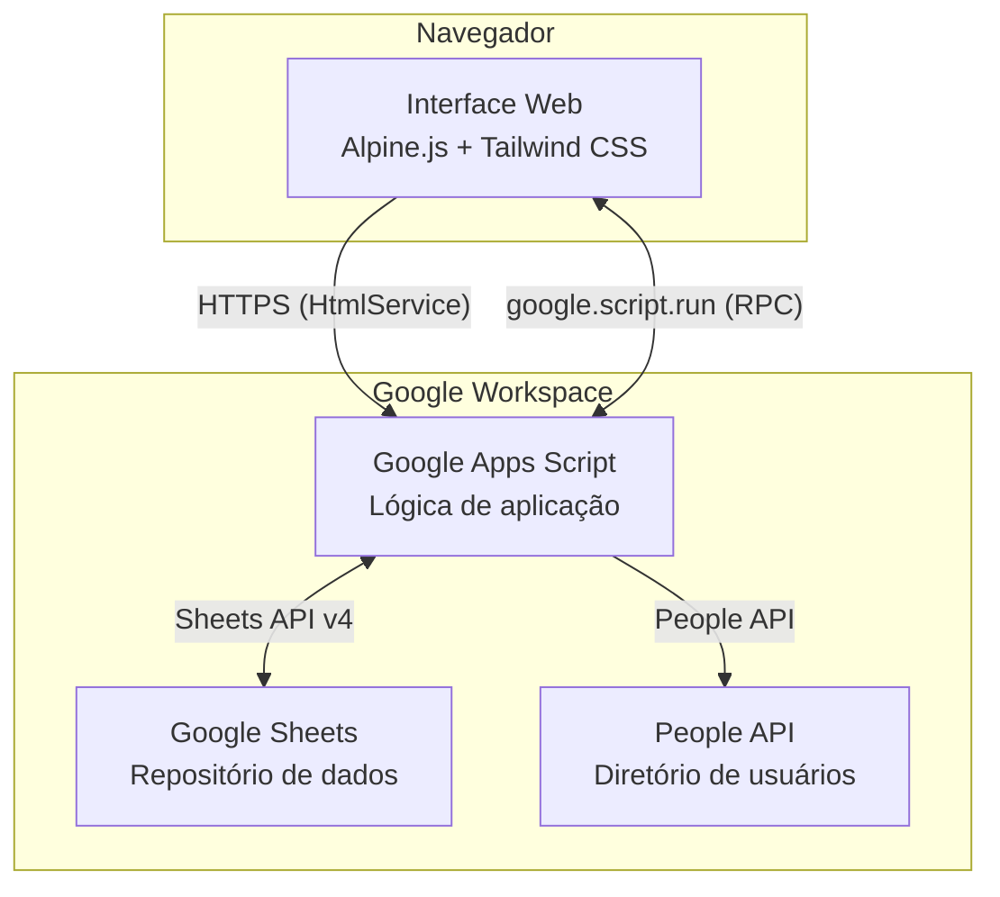
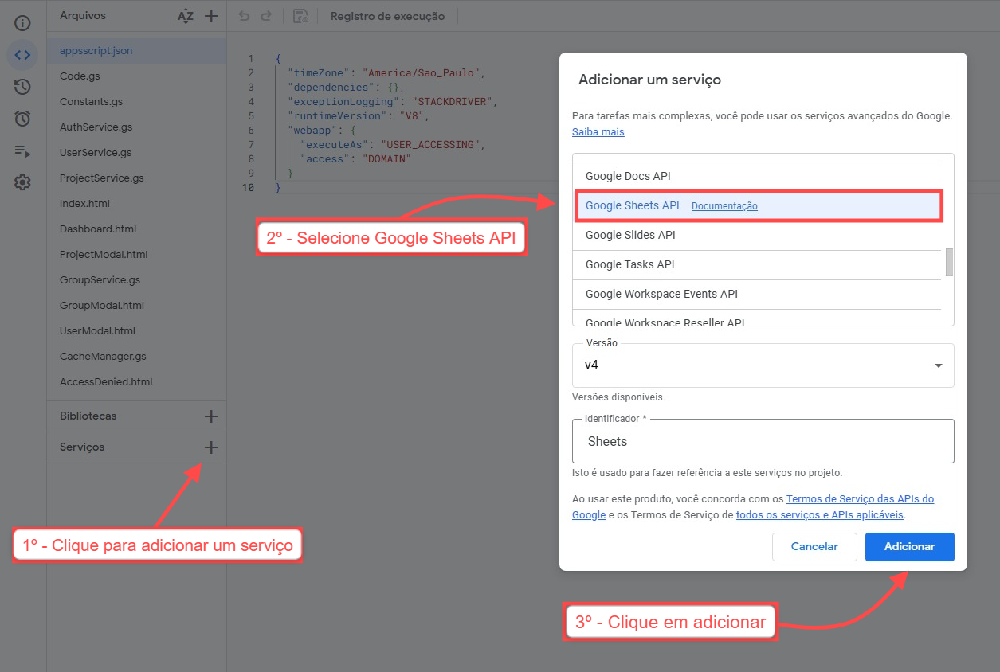
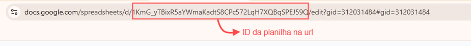
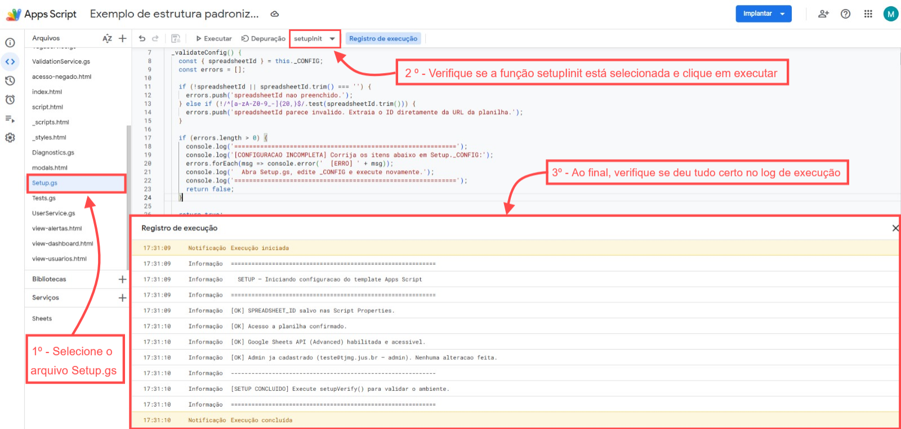
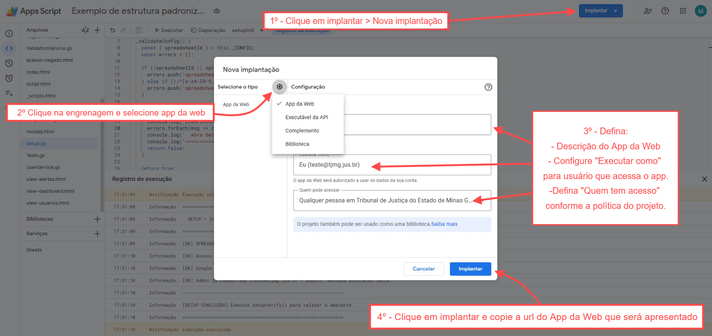

# CPE - Gestão de Vagas de Estágio

Ferramenta web criada para facilitar o trabalho do responsável pelo setor CPE na gestão de vagas de estágio. Antes, todo o controle era feito diretamente em planilhas: cadastros manuais, sem validações, sem visão consolidada. Esta ferramenta oferece uma interface visual simples para realizar as tarefas do dia a dia com mais praticidade.

> É uma ferramenta de apoio operacional para um setor com poucos usuários, não um sistema de gestão corporativo. Foi construída sobre Google Apps Script e Google Sheets, e tem limitações inerentes a essa plataforma.

## O problema que a ferramenta resolve

O setor CPE gerenciava as vagas de estágio por meio de uma planilha de controle. Planilhas são ferramentas poderosas: permitem buscas, fórmulas, formatação condicional, gráficos e diversas formas de extrair informações. No entanto, tirar proveito disso exige conhecimento técnico de planilhas, e a estrutura dos dados (como células mescladas) pode dificultar operações básicas como filtragem.

A necessidade levantada foi manter o mesmo controle, mas de forma visual e acessível, sem depender do domínio de planilhas para operar no dia a dia.

A ferramenta foi criada para isso. Ela não muda o que o setor faz, muda como faz: alertas de vencimento, visão consolidada das vagas e cadastros com validação automática, tudo sem precisar manipular a planilha diretamente.

## Por que a ferramenta foi construída assim

O setor já utiliza Google Workspace. Em vez de abrir uma demanda ao setor de TI para desenvolver e manter um sistema dedicado (com banco de dados, servidor e toda a infraestrutura associada), a solução foi construída diretamente sobre as ferramentas já disponíveis.

Isso garante:

- **Autonomia**: o próprio setor pode entender, ajustar e evoluir a ferramenta sem depender de terceiros
- **Custo zero de infraestrutura**: nenhum servidor, nenhum contrato adicional. Tudo roda dentro do Workspace já contratado
- **Entrega proporcional ao problema**: uma demanda bem delimitada, operada por poucas pessoas, não justifica um sistema robusto com toda a infraestrutura associada. Justifica uma solução que funcione bem dentro do seu contexto

A escolha pelo Apps Script não é uma limitação. É a escolha adequada para o tamanho e a natureza do problema.

## O que a ferramenta faz



| Módulo | O que resolve |
|---|---|
| **Vagas e Contratos** | Criação, alocação e controle de vigência de contratos de estágio |
| **Estagiários** | Cadastro centralizado com validação de CPF, e-mail e datas |
| **Alertas** | Contratos vencendo em 30 ou 60 dias, sem precisar procurar na planilha |
| **Dashboard** | Visão rápida de vagas ocupadas, livres e próximas do vencimento |
| **Órgãos e Cargos** | Estrutura judiciária para vincular vagas corretamente |
| **Setores e Gestores** | Departamentos e seus responsáveis atuais |
| **Magistrados** | Histórico de ocupações por cargo |
| **Usuários** | Controle de quem pode visualizar ou editar os dados |

## Ciclo de vida de uma vaga

Toda vaga pertence a um setor. Mesmo assim, ela pode existir sem estar alocada a nenhum destino específico. A alocação define onde a vaga está disponibilizada e tem três estados possíveis:

| Estado | Significado |
|---|---|
| Não alocada | Vaga existe no setor, mas ainda sem destino definido |
| Alocada ao setor | Vaga disponibilizada para uso do próprio setor |
| Alocada ao órgão | Vaga vinculada a um cargo específico em órgão julgador |

Além da alocação, uma vaga possui **ocupação**: indica se há um contrato ativo sobre ela. Não é um campo editável, é derivado dos contratos registrados. As duas características são independentes entre si.

A ocupação (presença de contrato ativo) é independente do estado de alocação: uma vaga em qualquer estado pode ou não ter estagiário vinculado.



A exclusão é permitida a partir de qualquer estado de alocação, desde que a vaga não possua contratos vinculados, nem histórico.

## Fluxo principal: contrato de estágio



## Perfis de acesso

A ferramenta adota o princípio de menor privilégio: cada perfil herda as permissões do anterior e acrescenta as suas.



## Arquitetura da solução

Toda a infraestrutura está dentro do Google Workspace. Não há servidor externo, hospedagem contratada ou banco de dados separado.



O Apps Script é uma plataforma de automação e integração do Google Workspace. Permite criar interfaces web reais (servidas via HTTPS), disparar execuções por agendamento ou eventos, e integrar nativamente com as ferramentas do ecossistema Google. O Google Sheets atua como repositório de dados da ferramenta. Toda a lógica de validação, consistência e controle de concorrência está na camada da aplicação (Apps Script), não na camada de dados.

### Tecnologias

| Camada | Tecnologia | Papel |
|---|---|---|
| **Backend** | Google Apps Script | Lógica de negócio, validações, controle de acesso |
| **Repositório de dados** | Google Sheets | Armazenamento de todos os registros em planilhas estruturadas |
| **Frontend** | Alpine.js + Tailwind CSS | Interface visual servida pelo próprio Apps Script |
| **Integrações** | Sheets API v4, People API | Operações em lote e foto/nome dos usuários |

### Dependências de interface

Todas carregadas via CDN externo no momento em que o usuário acessa a ferramenta.

| Biblioteca | Versão | Finalidade |
|---|---|---|
| Alpine.js | mais recente | Reatividade da interface (estado, eventos, renderização condicional) |
| Tailwind CSS | mais recente | Estilização via classes utilitárias |
| Lucide Icons | 1.8.0 | Biblioteca de ícones |
| Tippy.js | 6 | Tooltips e popovers |
| Popper.js | 2.11.8 | Posicionamento dos tooltips (dependência do Tippy.js) |
| Google Fonts | - | Tipografia (fontes Inter e Outfit) |

> **Atenção para quem for evoluir a ferramenta**: a interface depende dessas bibliotecas externas. Se alguma CDN ficar indisponível, partes da interface podem deixar de funcionar. Embora seja tecnicamente possível incluir as bibliotecas diretamente no projeto (vendorização), isso aumentaria o payload que o Apps Script precisa montar e entregar antes de responder ao browser, piorando o cold start, que já é o maior ponto de latência da plataforma. A alternativa mais equilibrada é hospedar os arquivos das bibliotecas em um repositório público no GitHub e servi-los via jsDelivr, que atua como CDN sobre o GitHub sem necessidade de cadastro ou publicação em registros externos. O formato da URL seria `cdn.jsdelivr.net/gh/{usuario}/{repositorio}@{versão}/{arquivo}`. Essa abordagem mantém a performance das CDNs externas e elimina a dependência de terceiros fora do controle do projeto.

## Limitações importantes

Cada ação realizada na interface dispara uma execução no servidor do Google. A plataforma tem cotas de execução por dia e operações de escrita são enfileiradas para evitar conflitos. Isso funciona bem para uso esporádico por poucas pessoas, mas pode gerar lentidão ou erros se muitos usuários tentarem gravar ao mesmo tempo.

- **Uso simultâneo**: projetada para uso esporádico por poucas pessoas, não para múltiplos usuários operando em paralelo
- **Latência**: cada operação é uma chamada ao servidor, mais lento que aplicações web convencionais. Isso é esperado e normal
- **Volume de dados**: planilhas com histórico muito extenso ficam mais lentas ao longo do tempo. É algo a monitorar após anos de uso

**Sobre manutenção futura**: se o desempenho degradar com o crescimento do histórico, a alternativa é fazer backup e reinicializar as planilhas mantendo apenas os contratos ativos. Pode ser feito manualmente ou, futuramente, automatizado com um script dedicado. Só fará sentido avaliar com base no uso real.

## Requisitos para implantação

Antes de começar, tenha em mãos:

- Conta Google com acesso ao [Google Apps Script](https://script.google.com)
- Uma **Google Spreadsheet** criada (o ID será necessário no setup)
- **Google Sheets API** habilitada no projeto
  - No editor: `Serviços` (+) > pesquise `Google Sheets API` > `Adicionar`



## Como implantar

### 1. Configurar o ID da planilha

Abra `Setup.gs` e edite o objeto `_CONFIG`:

```js
_CONFIG: {
  spreadsheetId: 'ID_DA_SUA_PLANILHA',
}
```

O ID está na URL da planilha: `docs.google.com/spreadsheets/d/**ID_AQUI**/edit`



O administrador inicial é detectado automaticamente a partir da conta que executar o setup.

### 2. Executar o setup inicial

No Apps Script Editor, execute:

```
setupInit()
```



Todos os itens devem aparecer com `[OK]` no log. Essa etapa cria todas as abas da planilha e configura as fórmulas do dashboard.

### 3. Verificar o ambiente

```
setupVerify()
```

Corrija qualquer item com `[ERRO]` antes de continuar.

### 4. Publicar como aplicativo web

1. `Implantar > Nova implantação`
2. Tipo: `App da Web`
3. Executar como: `Usuário que acessa o app`
4. Quem tem acesso: conforme a necessidade (domínio ou link)
5. Clique em `Implantar` e copie a URL gerada



### 5. Adicionar usuários

Acesse a ferramenta com a URL gerada e vá até **Usuários** para cadastrar os membros da equipe com seus perfis.

## Desenvolvimento e testes

Use a URL de desenvolvimento disponível em `Implantar > Testar implantações` durante o desenvolvimento. Ela sempre executa o código mais recente sem necessidade de nova versão. Só realize uma nova implantação após validar as mudanças.

## Estrutura da planilha

O setup cria automaticamente as seguintes abas na planilha configurada:

`logs` · `grupos` · `orgaos` · `cargos` · `ocupacoes` · `magistrados` · `setores` · `gestores_setor` · `estagiarios` · `contratos` · `vagas` · `dashboard`

> Não renomeie nem exclua essas abas manualmente. Alterações estruturais devem ser feitas via `Setup.gs`.

---

Desenvolvido pela **Unidade Avançada de Inovação em Laboratório - UAILAB**.
